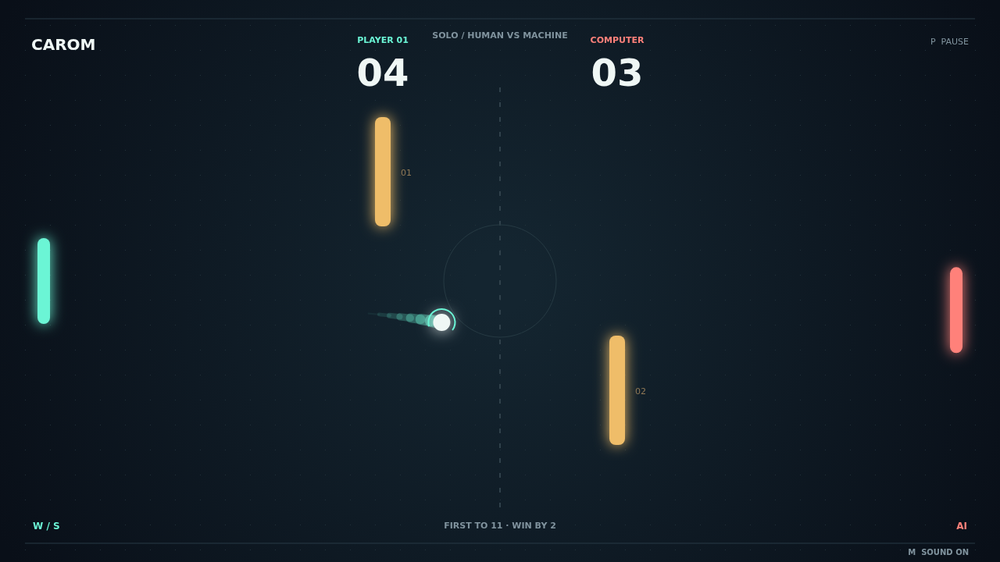

# Carom

Two paddles. Two obstacles. A thousand ways to miss the obvious shot. Carom is a
quick, precise duel on a dark court, where every return asks you to read the
angle and trust your timing. Take on the computer in Solo or share a keyboard
with a friend in Versus.

The opening serve gives you a moment to settle in. Then the rally gathers speed:
a clean center hit drives the ball across the court, while a touch near the end
of your paddle sends it climbing toward the wall. Move as you strike and your
return picks up spin, bending its flight long after it leaves you.

Those two amber bars change everything. A clear lane can become a bank shot;
a ball that looks safe can ricochet back into trouble. Follow the glowing trail,
find the space around the obstacles, and turn a desperate save into a shot your
opponent has to chase.

Every ball past the opposing paddle earns a point. Reach eleven with a two-point
lead to take the match, or fight through deuce until someone finally pulls away.
At match point, one well-timed moving return can be all the difference.

